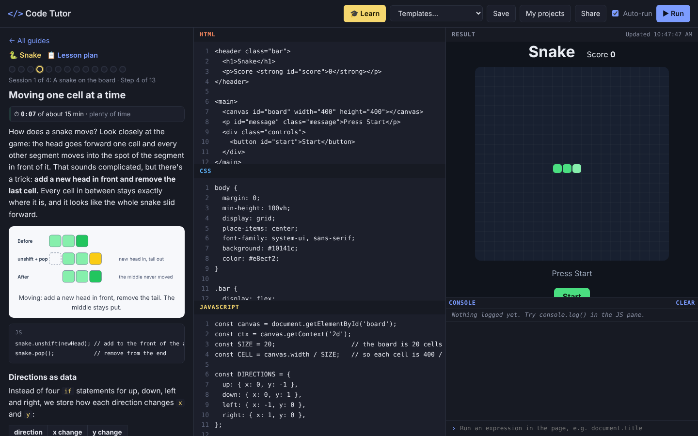
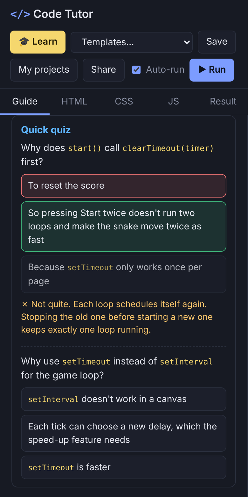
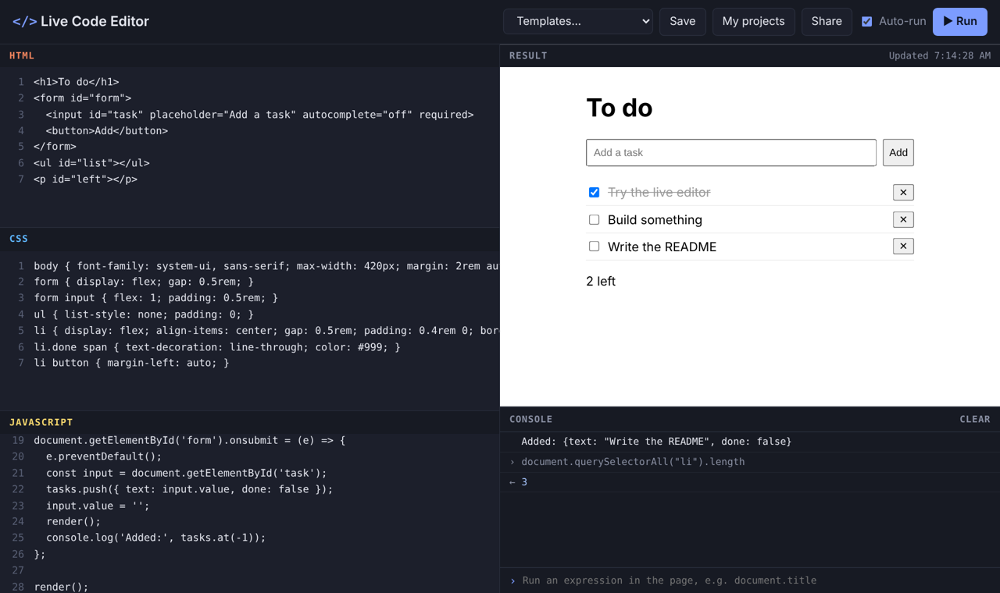
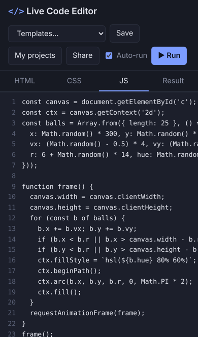

# Code Tutor (Live Code Editor)

**▶ [Open the editor](https://theoyanvno.github.io/live-code-editor/)** · **[Start the Snake guide](https://theoyanvno.github.io/live-code-editor/?learn)**

A live HTML, CSS and JavaScript editor with step-by-step guides that teach you to build my portfolio projects from a blank page. Press **🎓 Learn**, pick a project, and follow its lesson plan: each step explains one idea with diagrams, says what to write and why, **Check my work** looks at your code, a short quiz checks you understood it, and a pace timer keeps you on schedule. Stuck? Show what changes or load the answer.

Under the guides it's still a full editor: write HTML, CSS and JavaScript and see the result update as you type, like a small CodePen. It has a console that shows your `console.log` output and errors with line numbers, starter templates, links that share your code, and saves in the browser. No sign-up and no server.

**Tech:** vanilla JavaScript (ES modules) · HTML/CSS · sandboxed `<iframe srcdoc>` · `postMessage` · `CompressionStream` · `localStorage` · `node:test`









## Learn: build my projects step by step

| Guide | Steps | What you learn |
|---|---|---|
| 🐍 [Snake](https://github.com/TheoYanvno/snake-game) | 13 in 4 sessions · about 3 h · 26 quiz questions | Canvas drawing, a game loop, keyboard and swipe controls, keeping rules separate from drawing |
| 🔢 [Sudoku Solver](https://github.com/TheoYanvno/sudoku-solver) | 12 in 5 sessions · about 3 h · 22 quiz questions | Bitmasks, constraint propagation, recursion and backtracking, generating puzzles with one answer |

A new guide is added for each of my projects, easiest first: Quote & Joke Generator, Task Calendar, Sudoku Solver, Sticky Notes, Bonfire Notes, Marvel Character Database, Chess Coach, SuperBook, Gotham Hospital System, Blueit and Cybersecurity Intro Academy. Each guide is written against the project as it is in its repo today.

- **Lesson plan:** every guide opens with its goals, what you should know first, and its sessions: groups of steps for one sitting, each ending with a working project, with the planned minutes for every step.
- **Each step** explains one idea with examples, diagrams and tables, then lists what to write. The editor starts with that step's starting code.
- **Pace timer:** ⏱ counts your time on a step (only while the guide is open and the tab is visible) against its planned time, and suggests a hint when you're well over.
- **Quick quiz:** every step ends with multiple-choice questions on the idea behind the code, with an explanation for each answer.
- **Check my work** looks for each thing the step asks for (comments don't count) and shows a hint for anything missing.
- **Show what changes** shows the step's answer as a diff: added lines in green, removed lines struck through.
- **Load the answer** puts the step's finished code in the editor, so you can always catch up.
- **Progress** (the step you're on, the steps you've checked off, your time per step and your quiz answers) is saved in your browser. The finish page shows steps done, your quiz score and your time against the plan.
- **Read-along steps** at the end of each guide show how the real project is organized, with its tests.

Guides are written in Markdown ([`guides/`](guides/), format in [`guides/README.md`](guides/README.md)) and built into the modules in `src/lessons/` by [`scripts/build-guides.js`](scripts/build-guides.js). The tests check that every step's answer passes its own checks, that no check already passes before the step is done, and that every guide is a full lesson: goals, sessions of five steps or fewer, a planned time and a quiz for every step, and at least three diagrams.

## Editor features

- **Live preview:** runs your code half a second after you stop typing (or turn off Auto-run and press Run / Ctrl+Enter)
- **Console panel:** `console.log`, `warn` and `error` output, uncaught errors and rejected promises, with the line number in the JS pane. Type an expression at the bottom to run it inside the page.
- **Share:** copies a link with your code compressed into it; opening the link loads the code
- **Save** projects by name in your browser (Ctrl+S), and your work is kept automatically as a draft between visits
- **Templates:** click counter, responsive CSS Grid cards, a to-do list, a canvas animation, and promises with async/await
- **Project skeletons:** bare-bones starting points shaped like my other projects (hospital portal, character database, Snake, chess coach, SuperBook, task calendar, blog, quote generator, Sudoku solver and sticky notes). Each has the page layout and empty function stubs, with no working code, so you can build it up yourself.
- Editor comforts: line numbers, Tab inserts spaces, new lines keep the indentation
- On a phone, tabs switch between HTML, CSS, JS and Result

## How it works

**Running your code safely.** The result is an `<iframe>` with `sandbox="allow-scripts"` and *without* `allow-same-origin`. Your code runs in its own unique origin, so it can't read the editor page, its saved projects or its cookies. Each run sets a fresh `srcdoc`, so timers and event listeners from the previous run don't pile up.

**Building the page** ([`src/preview.js`](src/preview.js)). Your HTML is wrapped in a page with the CSS in the `<head>` and the JS at the end of the `<body>`. If you write a full page with `<html>` or `<body>`, your structure is kept and the CSS and JS are added in the right places. A `</script>` inside your JS (in a string, for example) would end the script tag early, so it's escaped as `<\/script>`, which means the same thing in JavaScript.

**The console** ([`src/console-bridge.js`](src/console-bridge.js)). Because the frame is sandboxed, the editor can't see its console directly. A small script is added to the top of the page that wraps `console.log` and friends, listens for `error` and `unhandledrejection`, and sends each message to the editor with `postMessage`. Each run has a random id, and the editor ignores messages from older runs or from any other window. Values are turned into readable text (objects, arrays, Maps, elements, circular references) before they're sent.

**Error line numbers.** The browser reports a line in the whole generated page. The editor works out where your JS starts in that page and subtracts, so "JS line 3" matches line 3 in the JS pane.

**Share links** ([`src/share.js`](src/share.js)). The three panes are saved as JSON, compressed with the built-in `CompressionStream('deflate-raw')`, and written as URL-safe base64 after the `#`. The part after `#` is never sent to a server, so the code stays between you and the person you share it with.

**The tutor** ([`src/tutor-core.js`](src/tutor-core.js), [`src/tutor.js`](src/tutor.js)). A guide's code is a list of named blocks per pane (for example the snake's `rules`, `draw` and `controls`). Each step replaces or adds blocks, and `assemble()` builds the full code after every step, so a step's starting code and its answer are always exact. The diff is a longest-common-subsequence line diff. The explanations use a small Markdown renderer that escapes everything first and only allows `https:` links, so a guide can't inject HTML. Diagrams are SVG shown through an `` with a `data:` URL, so nothing inside them can run. `lessonPlan()`, `pace()` and `gradeQuiz()` are plain functions, tested in Node like the rest.

**Saving** ([`src/storage.js`](src/storage.js)). Projects are stored in `localStorage`. Every read and write is wrapped in `try/catch`, because storage can be blocked in private windows; if saving isn't possible, you're told to use Share instead.

## Run it

No install needed. Serve the folder (ES modules don't load from `file://`):

```bash
npm start      # python3 -m http.server 8000, then open http://localhost:8000
npm test       # 38 tests (Node 18+)
npm run guides # rebuild src/lessons/ after editing a guide in guides/
```

| File | What it does |
|---|---|
| `src/app.js` | The editor UI: panes, running, console panel, templates, share, save |
| `src/preview.js` | Builds the preview page; debounce |
| `src/console-bridge.js` | The script injected into the preview, and value formatting |
| `src/share.js` | Compressing code into the URL and back |
| `src/storage.js` | Saved projects and the automatic draft |
| `src/templates.js` | Starter projects |
| `src/project-templates.js` | Bare-bones skeletons of my other projects |
| `src/tutor.js` | The guide panel: guide list, lesson plan, steps, pace timer, Check my work, diffs, answers, quizzes and progress |
| `src/tutor-core.js` | Building each step's code, Markdown with diagrams and tables, line diff, checks, lesson plan, pace, quiz grading and progress (no DOM, tested in Node) |
| `src/lessons/` | The built guides, plus the guide list in `index.js` |
| `guides/` | The guides in Markdown |
| `scripts/build-guides.js` | Turns the Markdown guides into `src/lessons/` modules |

Built with help from AI coding tools for planning, code review and tests.
